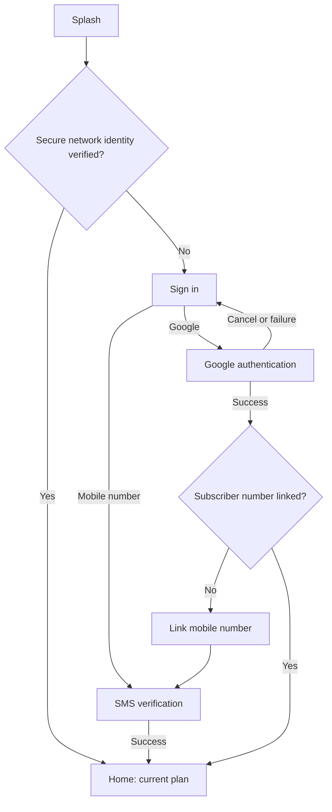

# English onboarding wireframes

Three folders contain the screens for each login case. Each screen is supplied separately as editable SVG and downloadable PDF. Repeated screens are included in each case so the case can be shared independently.

| Case | Screens |
| --- | --- |
| Mobile number | Splash, Sign in, SMS verification, Home |
| Google | Splash, Sign in, provider handoff, conditional Link number, conditional SMS verification, Home |
| Automatic network | Splash, Home; failed verification falls back to a normal login path |

Screen viewport: **390 x 844 logical px**. The surrounding 800 x 1040 sheet includes measurements and explanatory notes; it is not part of the app UI. Positions are relative to the viewport top-left. SVG/PDF annotations list each element's width, height, x and y. `dimensions.json` contains the same specifications.

Defaults: 24 px horizontal margins, 342 px content width, 48 px primary buttons, 56 px input fields, 8 px corner radius. Typography uses Arial/Helvetica. Home package values are illustrative.

## Flow overview

Open any SVG file on GitHub to view it. Download the corresponding PDF for a separate screen sheet. See each folder's FLOW.md for its conditions.
